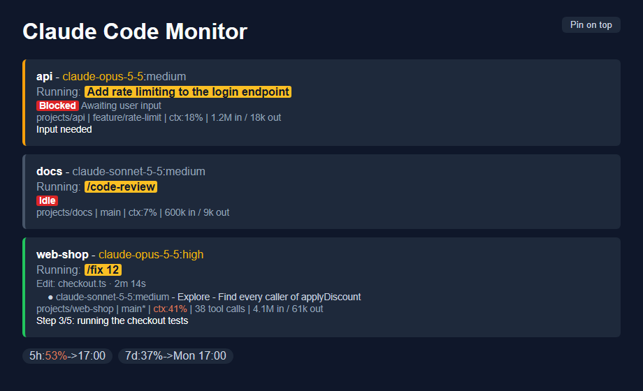

# Claude Code Monitor (CCM)

A small window that shows every Claude Code session you are using, one card per session. It is one Python file, `ccm.py`, with no
packages to install, shipped as a Claude Code plugin.



## Install
1. Install Python 3.10 or newer (see [Python](#python) below).
2. In a terminal (Claude Code v2.1.292 or later):
   ```text
   claude plugin install ccm --marketplace BenBellborn/claude-code-monitor
   ```
   This installs for your user, so the monitor runs in every project. If `--marketplace` is an unknown option, run
   `claude update` first.
3. Start a new session, or resume one. The monitor window opens. Close it, and it stays closed until the next
   session.

**Updates:** turn on auto-update once: `/plugin` > **Marketplaces** > `claude-code-monitor` > **Enable auto-update**. Without it,
update by hand with `/plugin marketplace update claude-code-monitor`. The running monitor keeps the old version until you close its
window.

## What it shows
- **Title bar:** `🟢 2 ⛔ 1`, sessions running and sessions waiting on you (blocked or idle).
- **Each card:**
  - session name, model and effort;
  - `Running:` with the current or last skill or prompt, highlighted;
  - a second line: what the session is doing right now and for how long, or a red `Blocked` (awaiting user input) or red `Idle`;
  - one row per subagent that is working;
  - a footer with your own statusline (folder, git branch, ctx%), the turn's tool calls and the tokens in/out.
- **Under the cards:** pills with the parts every session shares, for example `5h:34%->17:00`, `7d:34%->Mon 17:00`.

## How it behaves
- Starts with every new or resumed Claude Code session (a `SessionStart` hook). Only one runs
  at a time; a second start waits up to 25 s for one whose window just closed, then quits.
- Opens as a tab in your default browser. In Chrome or Edge its "Pin on top" button moves the cards into a picture-in-picture window
  that stays above other windows; closing that window puts them back in the tab.
- Closing the window stops it (after 20 s). The next session start opens it again.
- Listens on `127.0.0.1` only, on the first free port from 8080 to 8179.
- Reads `~/.claude/sessions`, `~/.claude/projects` (transcripts), `~/.claude/settings.json` (`statusLine`) and `~/.claude/cache`. Writes
  only to `~/.claude/cache`: the last statusline per session and the shared pills, so the cards are filled right after a restart, the
  sessions it has started for, and a lock file on Mac and Linux.

## Needs
- Claude Code. On Windows also Git for Windows, which Claude Code already needs; the monitor runs your statusline through its bash.
- Python 3.10 or newer, as `python3` or `python` on the PATH. Standard library only.
- Optional: Chrome or Edge for the "Pin on top" button.

| | Windows | Mac, Linux |
|---|---|---|
| Cards, statusline, title counts | yes | yes |
| One monitor at a time, closes with its window | yes | yes |
| "Pin on top" button | Chrome, Edge | Chrome, Edge |
| Tested | yes | not yet |

## Python
Check with `python3 --version` (Mac, Linux) or `python --version` (Windows).
- Windows: `winget install -e --id Python.Python.3.12 --scope user`. If `python` still opens the Microsoft Store, turn off the
  `python.exe` and `python3.exe` App execution aliases (Settings > Apps > Advanced app settings > App execution aliases).
- Mac: `brew install python`, or the installer from python.org. The Xcode tools' python3 is 3.9, too old.
- Linux: the distro package, for example `sudo apt install python3` or `sudo dnf install python3`.

## 5h and 7d pills
Claude Code passes the rate limits only to the statusline command, never to a file. The monitor runs your statusline itself, so to
show 5h and 7d your statusline script has to save them. Paste this prompt into Claude Code:

```text
Edit the script my statusLine.command in ~/.claude/settings.json runs. Right after it reads the JSON input from stdin, add this,
adapted to the script's language and its input variable (the bash version needs jq):

# Rate limits reach only the statusline; saved for ccm.py.
limits=$(echo "$input" | jq -c '.rate_limits // empty')
[ -n "$limits" ] && echo "$limits" > "$HOME/.claude/cache/rate-limits.json.$$" && mv -f "$HOME/.claude/cache/rate-limits.json.$$" "$HOME/.claude/cache/rate-limits.json"

Keep the write-to-temp-then-rename, so ccm.py never reads a half-written file. Change nothing else.
```

The monitor runs this script too, with the limits it last read, so the file can briefly hold slightly older limits until Claude
Code's next statusline run.

The statusline output is split on ` | `. A part that starts with `5h:` or `7d:`, or holds `rtk ` or `codemap `, goes to the pills;
every other part goes to the card footer. Model and effort are left out, since the card header shows them. No statusline at all
is fine: the footer then shows only tool calls and tokens.

## Progress line
A session can show its own progress as a white line at the bottom of its card, while it is busy or waiting; the monitor deletes the
line once the session is idle. The line `Waiting` instead shows an idle session as waiting, until its next prompt; a session that
ends its reply with questions writes it. A session writes the text to
`~/.claude/cache/progress/ccm-progress-<sessionId>.txt`; Claude Code sets `CLAUDE_CODE_SESSION_ID` in its shell:
```bash
mkdir -p ~/.claude/cache/progress && printf '%s' "Step 2/4: running tests" > ~/.claude/cache/progress/ccm-progress-$CLAUDE_CODE_SESSION_ID.txt
```
To have every session write it, paste this prompt into Claude Code:
```text
Add this section to my user-wide ~/.claude/CLAUDE.md, before any section about tools. Create the file if it is missing.
Change nothing else in it.

## Progress
In a task of 3 or more steps, at the start of each step, write one short line (`Step 2/4: running tests`) for the Claude Code
Monitor. Not in a subagent: it shares the session's file.
`mkdir -p ~/.claude/cache/progress && printf '%s' "<line>" > ~/.claude/cache/progress/ccm-progress-$CLAUDE_CODE_SESSION_ID.txt`
Before a reply that ends with open questions, write `Waiting` as the line: the monitor shows the session as waiting until
the next prompt.
```

## Stop or remove
- Stop: close the window; the process exits within 20 s. By hand: on Windows end the `pythonw.exe` running `ccm.py` in Task Manager;
  on Mac and Linux run `pkill -f ccm.py`.
- Remove: `/plugin uninstall ccm@claude-code-monitor`, then delete these files in `~/.claude/cache`: `cc-monitor-statuslines.json`,
  `cc-monitor-statuslines.json.tmp`, `ccm.lock`, `ccm-started-sessions.txt` and `ccm-started-sessions.lock`, and the `progress` folder.

Or paste one of these prompts into Claude Code.

Stop:
```text
Stop the Claude Code Monitor: end the process running ccm.py (on Windows the pythonw.exe running it, on Mac and Linux
pkill -f ccm.py). Leave the plugin installed.
```

Remove:
```text
Remove the Claude Code Monitor completely:
1. Stop the process running ccm.py (on Windows the pythonw.exe running it, on Mac and Linux pkill -f ccm.py).
2. Run claude plugin uninstall ccm@claude-code-monitor, then claude plugin marketplace remove claude-code-monitor.
3. Delete these files in ~/.claude/cache: cc-monitor-statuslines.json, cc-monitor-statuslines.json.tmp, ccm.lock,
   ccm-started-sessions.txt, ccm-started-sessions.lock, rate-limits.json and the progress folder.
4. If the script my statusLine.command runs saves rate_limits to rate-limits.json "for ccm.py", remove those lines.
   Change nothing else in it.
5. Remove the "## Progress" section for the Claude Code Monitor from ~/.claude/CLAUDE.md, if it is there.
```

## Troubleshooting
- **Nothing opens:** a monitor is still running. Close its window, or stop it, and start a new session.
- **Window turns blank:** it opened while the monitor was restarting. On Windows the monitor replaces it within 6 s; F5 always works.
- **No footer:** check that your `statusLine.command` runs in bash, and that `jq` is installed if your script uses it.
- **Install or update fails with a git error:** without a GitHub SSH key, set the environment variable
  `CLAUDE_CODE_PLUGIN_PREFER_HTTPS=1` so Claude Code clones over HTTPS, then try again.
- **Nothing at all:** run `python3 --version` or `python --version`; the plugin needs one of them on the PATH.

## License
MIT
